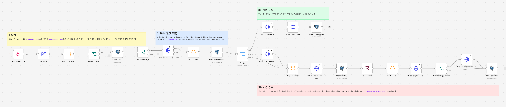
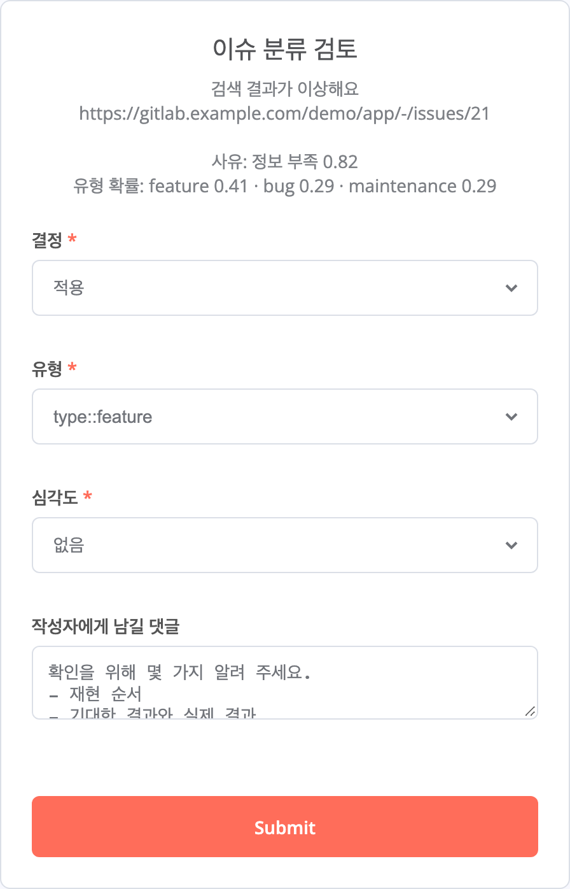

# GitLab 이슈 분류 자동화 (n8n + 결정 모델 + 사람 검토)

GitLab에 이슈가 올라오면 n8n이 Webhook으로 받아 유형과 심각도를 분류합니다. 확신이 서는 건만 자동으로 라벨을 붙이고, 나머지는 담당자에게 검토 폼을 보냅니다.

- **분류**: 결정 모델이 합니다. 결정 모델은 글을 쓰지 않고, 정해 둔 선택지에서 고른 답과 확률만 돌려줍니다. [TypeSafe Jev](https://docs.typesafe.ai/introduction), Inception Mercury Decide 등이 같은 `/v1/systemone` 규격을 씁니다.
- **판정**: 자동으로 처리할지 사람에게 넘길지는 기준값을 보고 코드가 정합니다.
- **최종 결정**: 담당자가 합니다.



## 흐름

1. **받기**: GitLab 이슈 Webhook을 `X-Gitlab-Token`으로 확인합니다. `Idempotency-Key`를 PostgreSQL에 먼저 기록해서, GitLab이 같은 이벤트를 다시 보내도 한 번만 처리합니다. 열림·다시 열림 이벤트만 처리하고, 작성자가 `type::` 라벨을 직접 단 이슈는 건너뜁니다.
2. **분류**: 결정 모델에 한 번 호출해 질문 네 개를 묻습니다.

   | 질문 | 형식 | 답 |
   |---|---|---|
   | 유형 | choice | bug, feature, maintenance 중 하나 + 확률 + 확신도 |
   | 심각도 | score | 4단계 점수 + 확신도 → `severity::1`~`4` (bug일 때만) |
   | 보안 의심 | noul | 0~1 확률 |
   | 정보 부족 | noul | 0~1 확률 |

3. **경로 결정**: `Settings` 노드의 기준값으로 `Decide route` 코드 노드가 정합니다.
   - 보안 의심 0.35 이상: 담당자 검토. LLM을 부르지 않고 공개 댓글도 달지 않습니다.
   - 정보 부족 0.6 이상: LLM이 작성자에게 보낼 질문 초안을 쓰고, 담당자 검토로 보냅니다.
   - 유형 확신도 0.9 이상(bug면 심각도 확신도 0.6 이상도): 라벨을 자동으로 붙이고, 근거(확률)를 댓글로 남깁니다. 0.9는 아래 평가에서 정했습니다.
   - 그 밖: 담당자 검토.
   - 결정 모델이 세 번 재시도한 뒤에도 실패하면 제안 없이 담당자 검토로 갑니다.
4. **사람 검토**: 담당자를 멘션한 내부 메모(비공개)로 검토 폼 링크를 보냅니다. 폼에는 AI 제안과 질문 초안이 미리 채워져 있습니다. 담당자가 고르거나 고친 라벨과 댓글만 GitLab에 반영합니다. 72시간 동안 응답이 없으면 `triage::needs-human` 라벨만 붙입니다.
5. **기록**: 모든 이벤트의 결정 모델 답, 경로, 제안, 최종 결정을 `triage.issue_triage`에 남깁니다. `triage.review_outcomes` 뷰에서 담당자가 제안을 그대로 승인했는지, 고쳤는지, 거절했는지를 경로별로 셉니다. 기준값을 조정할 때 이 숫자를 봅니다.



### 이렇게 나눈 이유

- **결정과 글쓰기를 나눴습니다.** 분류처럼 고르는 일은 결정 모델이 맡습니다. 선택지 밖의 라벨이 나올 수 없고 확률이 함께 나와서, "어디까지 자동으로 처리할지"를 숫자로 정할 수 있습니다. 글은 작성자에게 질문할 때만 생성 모델이 씁니다.
- **LLM이 쓴 글은 사람이 승인해야 공개됩니다.** 자동 경로에서 다는 댓글은 코드 템플릿입니다.
- **모델 교체가 쉽습니다.** 결정 모델은 `/v1/systemone` 규격으로, 글쓰기 모델은 OpenAI 호환 API로 부릅니다. 둘 다 주소와 모델 이름만 바꾸면 교체됩니다. 데이터를 밖으로 보낼 수 없는 곳에서는 글쓰기 모델을 사내 vLLM이나 Ollama로 돌릴 수 있습니다.

## 어떤 모델을 쓰나

| 용도 | 기본값 | 비용 | 바꾸려면 |
|---|---|---|---|
| 결정 | `inception/mercury-decide:free` (OpenRouter) | 무료 | `DECISION_MODEL=~typesafe/jev-latest` 등 |
| 글쓰기 | `gemini-2.5-flash` (Google AI Studio) | 무료 한도 안에서 0원 | `LLM_BASE_URL`, `LLM_MODEL` |

OpenRouter 무료 모델에는 한도가 있습니다.
- **분당**: 20회
- **하루**: 50회. OpenRouter에 크레딧을 한 번이라도 $10 이상 충전했다면 하루 1,000회입니다.

이 숫자는 [2026년 10월 기준 정리](https://klymentiev.com/blog/openrouter-free-tier)를 따랐고, 결정 모델에도 같은 한도가 적용되는지는 공식 문서에서 확인하지 못했습니다. 무료 엔드포인트는 공급자에 따라 입력을 기록하거나 학습에 쓸 수 있습니다. 실제 고객 데이터에는 OpenRouter에서 공급자의 데이터 정책을 확인한 유료 모델을 쓰세요.

## 키 없이 돌려 보기

GitLab, 결정 모델, LLM을 흉내 내는 가짜 서버(`mock/`)와 함께 실제 n8n과 PostgreSQL을 띄워 시나리오 7개를 확인합니다.

```bash
scripts/test.sh          # 끝난 뒤에도 스택을 남겨 둠 (http://localhost:5678)
scripts/test.sh --down   # 끝나면 컨테이너와 볼륨 삭제
```

| 시나리오 | 확인하는 것 |
|---|---|
| 틀린 Webhook 토큰 | 403, 아무것도 기록하지 않음 |
| 명확한 버그 | 라벨 자동 적용, 근거 댓글, 같은 `Idempotency-Key` 재전송은 무시 |
| 정보가 부족한 이슈 | LLM 초안 → 내부 메모 → 폼(서명된 링크)에서 담당자가 라벨과 댓글을 고침 → 고친 내용만 반영 |
| 보안 의심 | LLM 미호출, 담당자 거절 → `triage::needs-human`, 공개 댓글 없음 |
| 확신도 낮음 | 담당자가 제안대로 승인, 빈 댓글은 달지 않음 |
| 결정 모델 과부하(529) | 세 번 재시도 후 제안 없이 담당자 검토 |
| 처리 대상이 아닌 이벤트 | 수정 이벤트, 이미 분류된 이슈, 이슈가 아닌 이벤트 무시 |

GitHub Actions(`.github/workflows/e2e.yml`)도 같은 스크립트를 돌립니다.

## 실제 GitLab에 연결하기

1. `.env.example`을 `.env`로 복사하고 값을 채웁니다.
   - OpenRouter API 키(`DECISION_API_KEY`)
   - Gemini API 키(`LLM_API_KEY`)
   - GitLab 프로젝트 액세스 토큰: `api` 권한, Reporter 이상
   - `TRIAGE_REVIEWER`: 검토를 맡을 GitLab 사용자 이름
2. `scripts/setup.sh`를 실행합니다. 자격 증명을 n8n에 넣고(n8n이 `N8N_ENCRYPTION_KEY`로 암호화), 워크플로를 불러와 게시합니다.
3. GitLab이 n8n에 닿을 수 있어야 합니다. 예를 들어 `tailscale funnel 5678`로 HTTPS 주소를 열고, 그 주소를 `N8N_PUBLIC_URL`에 넣은 뒤 `scripts/setup.sh`를 다시 실행합니다.
4. GitLab 프로젝트에서 **Settings → Webhooks**로 갑니다.
   - URL: `<N8N_PUBLIC_URL>webhook/gitlab/issues`
   - Secret token: `GITLAB_WEBHOOK_SECRET`
   - Trigger: **Issues events**
5. 프로젝트에 `type::bug`, `type::feature`, `type::maintenance`, `severity::1`~`4`, `triage::needs-human` 라벨을 만듭니다.

## 정확도 재기

결정 모델들은 모두 2026년 9~10월에 나왔고, 성능 수치는 회사 발표뿐입니다. 그래서 직접 쟀습니다. 정답은 공개 저장소 `gitlab-org/gitlab`에서 GitLab 팀이 이슈에 붙인 `type::` 라벨입니다.

### 결과 (2026-10-14, 이슈 150건, 유형별 50건)

| 모델 | 정확도 | 응답 시간 (중앙값) | 1,000건당 비용 | 확신도 |
|---|---|---|---|---|
| Mercury Decide (`inception/mercury-decide:free`) | **80.7%** (121/150) | **0.64초** | **$0** | 있음 |
| Gemini 2.5 Flash (JSON 스키마) | 80.0% (120/150) | 2.57초 | $0.26 | 없음 |
| Jev (`typesafe/jev-1.13`) | 77.3% (116/150) | 0.67초 | $0.045 | 있음 |

Mercury Decide의 확신도 기준별 결과입니다.

| 확신도 기준 | 자동 처리 비율 | 그 안의 정확도 |
|---|---|---|
| 0.8 이상 | 82.7% (124건) | 86.3% |
| 0.9 이상 | 72.7% (109건) | 89.9% |

- **기본 모델**: 정확도는 생성 모델과 같은데 4배 빠르고 무료라서 Mercury Decide를 기본으로 했습니다.
- **자동 적용 기준**: 처음에 0.8로 잡았다가 0.9로 올렸습니다. 이슈 넷 중 셋은 자동으로 처리되고, 그중 열에 아홉이 맞습니다. 라벨은 되돌리기 쉽고 자동 댓글에 확률이 남아서, 틀린 10%는 사람이 보고 고칠 수 있습니다.
- **두 모델 합의**: Mercury와 Jev가 같은 답일 때만 자동으로 처리하면 정확도는 92.2%로 오르지만, 자동 처리 비율이 60%로 떨어져서 넣지 않았습니다.
- **틀리는 곳**: 대부분 feature와 maintenance의 경계였습니다. 16건은 세 모델이 같은 답을 냈는데 GitLab 라벨과 달랐습니다. 라벨 자체가 애매한 이슈로 보입니다.

원자료는 `eval/results-2026-10-14.jsonl`(이슈 번호, 정답, 모델 답, 확률, 지연, 비용)이고, 요약은 `eval/RESULTS.md`입니다.

### 다시 돌리기

```bash
python3 eval/build_dataset.py --per-type 50       # 유형별 50건, 2026-09-20 이후 생성된 이슈
python3 eval/run_eval.py --limit 45               # 무료 하루 한도 안에서 (결정 모델 45회 + Gemini 45회)
python3 eval/run_eval.py --resume eval/results/<파일>.jsonl   # 다음 날 이어서
python3 eval/run_eval.py --models inception/mercury-decide:free,typesafe/jev-1.13,llm \
    --llm-base-url https://openrouter.ai/api/v1 --llm-model google/gemini-2.5-flash \
    --llm-key-var OPENROUTER_API_KEY            # 위 결과를 만든 명령
```

- 모든 모델에 워크플로와 같은 지시문과 기준을 줍니다. LLM은 JSON 스키마로 답하게 합니다.
- 결과에는 정확도, 유형별 재현율, 지연 시간, 비용, 모델끼리 답이 같은 비율이 나옵니다.
- 결정 모델은 확신도 기준별로 "자동 처리 비율"과 "그 안의 정확도"도 냅니다. `Settings`의 기준값은 이 표를 보고 정합니다.
- 한도에 걸리면 멈추고, 이어서 돌릴 명령을 알려 줍니다.
- 이슈 번호는 `eval/dataset.csv`에 남기고, 본문은 커밋하지 않습니다(`eval/.cache/`).

## 한계

- 72시간 만료 경로는 자동 테스트하지 않았습니다.
- 정답 라벨이 유형에만 있어서, 심각도·보안·정보 부족 판단은 정확도를 재지 않았습니다.
- 평가는 GitLab 자체 이슈 150건입니다. 다른 조직의 이슈에서는 기준값을 다시 재야 합니다.
- 자동 적용된 라벨을 나중에 사람이 고쳐도 기록하지 않습니다. 라벨 변경 이벤트를 받아 기록하면 실제 운영 정확도를 잴 수 있습니다.
- 검토 폼 링크는 n8n이 서명해서 추측할 수 없지만, 링크를 가진 사람은 누구나 제출할 수 있습니다. 그래서 링크는 프로젝트 멤버만 보는 내부 메모로만 보냅니다.
- n8n은 2.43.4로 고정했습니다. 다른 버전에서는 노드 버전 차이를 확인해야 합니다.

## 구성

```
docker-compose.yml        n8n 2.43.4 + PostgreSQL 17
compose.mock.yml          테스트용: 바깥 API를 mock으로 돌림
workflows/issue-triage.json
db/init.sql               triage 스키마, 결과 집계 뷰
mock/mock_server.py       GitLab·결정 모델·OpenAI 호환 API 흉내 (표준 라이브러리만)
scripts/setup.sh          자격 증명·워크플로 불러오기와 게시
scripts/test.sh           새 스택으로 시나리오 테스트
eval/                     정답셋 만들기, 결정 모델과 LLM 비교
```
